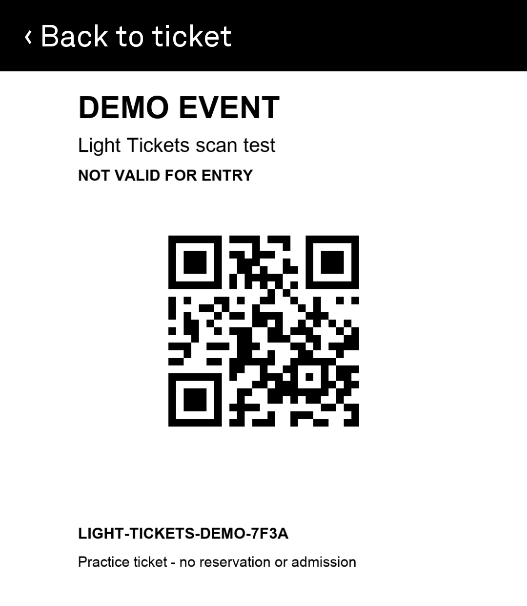

# Light Tickets

An offline holder for ticket PDFs and static ticket images on Light Phone III.

This is a community preview, version **0.4.3**. It is not an official Light app and has not been approved for the Tool Library.

## What it does

- Receives PDFs and PNG, JPEG, or WebP images from an iPhone or laptop browser on the same Wi-Fi.
- Asks for approval on the Light Phone before saving each file.
- Keeps saved copies available offline.
- Displays multi-page PDFs, pinch and pan, focused double-tap zoom, and Fit.
- Provides a full-screen scanning view with a visible Back button.
- Keeps an open ticket or active receiving screen awake.
- Preserves a bookmarkable upload address while the phone's Wi-Fi address stays the same; a changed address produces a notice until acknowledged.

Only the dummy practice ticket and demo screenshots are included in this repository.

## Sending a ticket

1. Put the sending device and Light Phone on the same trusted private Wi-Fi.
2. In Light Tickets, choose **Receive wirelessly → Start receiving**.
3. Scan the phone's QR with the other device, or open its displayed address in a browser and enter the fresh pairing code.
4. Choose a PDF or supported image and send it.
5. Tap **Save** on the Light Phone.

The saved copy can then be opened without Wi-Fi or a USB cable. Choose **Full screen**, double-tap, or pinch to enlarge the code. Removal is under **Options → Remove saved copy** and requires confirmation.

## Ticket compatibility

Use PDFs or saved images whose issuer permits this form of admission. The app does not validate a ticket or guarantee venue acceptance. Rotating barcodes, provider logins, automatic updates, NFC admission, payments, and email import are not supported.

Imports are limited to 20 MB per document, 100 pages per PDF, and 50 saved documents. Password-protected or malformed PDFs may be rejected.

## Privacy

The app has no account, ads, analytics, or ticket-provider connection. Saved tickets use private app storage. Removing a saved copy leaves the original file on the sending device untouched.

**Local transfer uses unencrypted HTTP. Use trusted private Wi-Fi.** Receiving is explicitly started, foreground-only, limited to three minutes and one file, and uses fresh pairing credentials. Five incorrect pairing codes end the session. Leaving the receiving screen or app closes it. The receiver has no routes to list or download saved tickets.

Real ticket views and temporary pairing information use a protected display window; the dummy practice view permits screenshots. There is no separate ticket PIN. The SDK's Android-backup exclusion remains unresolved: **do not assume tickets are excluded from device backups or transfer**. This preview has been tested with practice files while that question is open.

## Development and review

See [BUILDING.md](BUILDING.md) for the pinned SDK and local build steps, [VALIDATION.md](VALIDATION.md) for completed checks, and [KNOWN_ISSUES.md](KNOWN_ISSUES.md) for remaining work. Light's source build requires the repository-root `gradle.properties` as well as `tool/`.

Source publication and Tool Library approval are separate steps. Nothing in this repository claims approval or a production release. The existing standalone prototype uses a different app package; this preview does not migrate its saved tickets.

## License and credits

Licensed under the [MIT License](LICENSE). Copyright © 2026 [izzystst](https://github.com/izzystst). Third-party components retain their own licenses, listed in [THIRD_PARTY_NOTICES.md](THIRD_PARTY_NOTICES.md).
